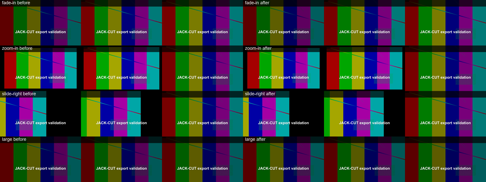

**JACK-CUT local export optimization — 14 October 2026**

The changes reduce fade sampling and duplicate overlay branches. The production failure is **not confirmed fixed**: comparable server CPU, RAM, concurrency, and FFmpeg build have not been tested. The mostly static 10-minute fixture showed no end-to-end speedup in the final run.

The requested checkout is D:\pull from git\JACK-CUT, branch Jack, baseline commit d21b5c5b505eb3f195a76066f722657601130e81. Its working tree was initially clean. No branch switch, commit, push, deployment, timeout change, or project-data change was made. Both existing local environment files retain EXPORT_TIMEOUT_MS=7200000.

For production job 3a3b2e9a-b187-4cc9-b6a7-fe23d2d82eda, the supplied evidence shows total_timeout with a 140 ms heartbeat age at approximately 61% after two hours. The worker was alive when the saved total deadline expired. The optimization addresses rendering cost; it does not change deadline or recovery behavior.

Fade-only clips at the default parent transform use a per-frame alpha LUT at every amount, including 50%. Commands come from the shared animation math, so partial fades, durations, overlapping fade products, and legacy settings retain their values. Color channels explicitly use identity LUTs, and source alpha is multiplied rather than replaced. The LUT bypasses static intervals, and unchanged opacity does not rebuild it.

The controller uses one stream and one overlay for these fades instead of a split static/animated pair. For transformed still images, it caches the fixed color inverse map once and samples source alpha with the original bilinear map before multiplying opacity. This preserves fractional scale/position and avoids rounding alpha before fading. For disjoint zoom/slide and fade phases at the default parent transform, it retains the spatial sampler and replaces the separate fade GEQ with the LUT. Transformed videos, overlapping spatial phases, and legacy spatial trajectories retain the existing sampler. No stored animation, layout, encoder, frame-rate, or quality setting was changed.

Tests used Windows, an 12th Gen Intel(R) Core(TM) i5-12400F, 12 logical CPUs, 31.8 GiB RAM, Node v24.21.0, and FFmpeg 9.0.2-full_build-www.gyan.dev. Both sides used 1920×1080 at 30 fps, libx264 medium/CRF 23, AAC, and one configured decode/filter/encoder thread. Times are single-run wall times for the FFmpeg process, including encoding, muxing, and faststart; source preparation, database work, uploads, and renderer-slot waits are excluded. Memory is FFmpeg-reported maxrss converted from KiB to MiB. Inputs and output settings were identical within each pair.

| Input | Before seconds | After seconds | Before peak MiB | After peak MiB |
|---|---:|---:|---:|---:|
| 50% fade, 3 seconds | 10.91 | 3.94 | 448.2 | 439.2 |
| 50% zoom plus fade, 3 seconds | 22.71 | 17.90 | 465.8 | 465.7 |
| 50% slide plus fade, 3 seconds | 21.77 | 16.69 | 465.4 | 465.4 |
| 24-clip overlay graph, 3 seconds | 26.69 | 7.57 | 1227.5 | 1024.5 |
| 10-minute fixture | 503.80 | 519.46 | 554.1 | 553.8 |

The short fade run is 63.9% faster; the 24-clip graph is 71.6% faster and has 24 overlays instead of 48. The final 10-minute render is 3.1% slower in this single trial. The long fixture contains only three media clips with short animation windows and a long static interior, so these results do not demonstrate a general long-project speedup. Server validation remains required.

The 10-minute controller-generated local fixture uses three 200-second transparent image clips (fade, zoom, slide), a caption with animation, and a 440 Hz tone in the base audio input. It exercises the real graph builder and FFmpeg with isolated model/storage stubs; it does not create or edit saved projects or exercise persistence/upload services. The final output is 600 seconds, 18,000 H.264 frames at 1920×1080/30 fps, plus 600 seconds of audible AAC (-21.1 dB mean). Full playback decoding succeeded.

Every decoded frame in all 16 before/after pairs is identical (PSNR infinity), including all 18,000 frames of the long output. The matrix covers 0%, 1%, 25%, 50%, 75%, 100%, true legacy fade rows, overlapping fades, fractional parent scale/position, source video transparency, and the cinematic effect. The additional raw-plane regression covers all integer amounts 0–100 and disjoint static interiors at 1%, 37.5%, 50%, and 100%, with an alpha gradient and full-range color values; all color and alpha bytes match the original GEQ. 287/287 backend tests pass. An existing route-test mock omitted updateProject; its fixture was corrected without changing the route or production controller.

The transformed-image optimization trades additional cached frames for speed; its measured peak memory can increase. The optimized 24-clip graph still uses approximately 1 GiB on this host. These measurements do not establish suitability for a smaller server or the production project's asset/clip mix.

| 0.6-second matrix input | Before seconds | After seconds | Before peak MiB | After peak MiB |
|---|---:|---:|---:|---:|
| fade0 | 0.656 | 0.683 | 222.9 | 222.7 |
| fade1 | 3.080 | 0.918 | 227.1 | 223.8 |
| fade25 | 3.279 | 1.298 | 227.1 | 223.3 |
| fade50 | 3.346 | 1.345 | 226.9 | 223.8 |
| fade75 | 3.355 | 1.324 | 226.8 | 224.0 |
| fade100 | 3.324 | 1.273 | 226.8 | 224.2 |
| legacy | 4.996 | 1.408 | 227.0 | 225.0 |
| transformed | 8.098 | 4.820 | 225.1 | 240.5 |
| overlap | 4.377 | 1.251 | 226.9 | 223.7 |
| video | 3.610 | 1.463 | 315.9 | 267.7 |
| fx | 3.328 | 1.185 | 242.8 | 234.5 |

Representative frames at 0.10, 0.33, and 2.67 seconds are shown below. Each row has three baseline frames on the left and three optimized frames on the right.



To reproduce on comparable server resources, run these commands from the repository root using the same FFmpeg binary, CPU/RAM limits, and concurrency for both sides. The benchmark writes only generated fixtures/results to a temporary directory (or EXPORT_BENCHMARK_DIR), and uses the recorded baseline ref by default. FFMPEG_PATH may select the server binary. Keep EXPORT_TIMEOUT_MS=7200000 and do not deploy these changes before deciding on server validation.

```powershell
node backend/scripts/benchmarkExport.cjs before --baseline
node backend/scripts/benchmarkExport.cjs verified
node backend/scripts/benchmarkExport.cjs matrix-before --baseline --matrix
node backend/scripts/benchmarkExport.cjs matrix-after --matrix
node backend/scripts/benchmarkExport.cjs long-before --baseline --long
node backend/scripts/benchmarkExport.cjs long-after --long
node backend/scripts/compareExportFrames.cjs
cd backend
npm test
```

The original baseline ref must be available locally; --baseline-ref=<ref> can select another compatible baseline. The JSON beside this report contains the measured cases, frame comparisons, validation metadata, and test totals. Large MP4s, exact command arguments, ASS files, fade commands, and logs remain in the isolated export-benchmark artifact directory used during this task.
